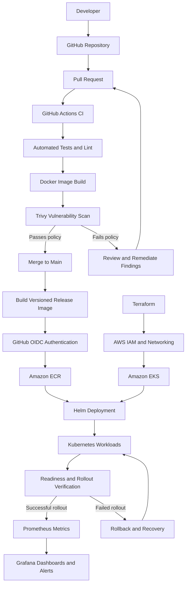

# CloudCart — System Architecture & DevOps Design

**Project:** CloudCart — Production-Ready DevOps Platform  
**Document Type:** Technical Architecture  
**Status:** Proposed — implementation and validation in progress  
**Version:** 1.0

---

## 1. Overview

CloudCart is a containerized e-commerce application designed to demonstrate a complete, automated DevOps lifecycle, from source-code changes to deployment, monitoring, and recovery.

The project combines application development with modern DevOps practices, including Continuous Integration and Continuous Deployment (CI/CD), containerization, infrastructure as code, container security, Kubernetes orchestration, deployment automation, and observability.

The primary objective is to create a reproducible deployment process that is secure, traceable, maintainable, and capable of recovering from application deployment failures.

## 2. Objectives

The architecture is designed to achieve the following objectives:

- Automate application testing and build validation.
- Package the application into versioned Docker images.
- Scan container images for known vulnerabilities using Trivy.
- Store approved container images in Amazon Elastic Container Registry (ECR).
- Provision and manage AWS infrastructure using Terraform.
- Deploy the application to Kubernetes using Helm.
- Implement health probes, rolling updates, and rollback procedures.
- Collect application and infrastructure metrics using Prometheus.
- Visualize operational metrics and configure alerts using Grafana.
- Maintain documentation for setup, deployment, troubleshooting, and incident recovery.

## 3. Scope

### 3.1 Application scope

The initial application will be a Node.js and Express REST API.

Planned endpoints:

| Endpoint | Purpose |
|---|---|
| `GET /health` | Check application health |
| `GET /api/products` | Return a list of products |
| `GET /metrics` | Expose application metrics for Prometheus |

The metrics endpoint will be introduced during the monitoring phase. It must not expose secrets or sensitive application information.

A React frontend, database integration, authentication, and additional e-commerce features may be introduced after the initial DevOps pipeline works.

### 3.2 DevOps scope

The platform includes:

- Git and GitHub for version control.
- GitHub Actions for automated workflows.
- Docker for application containerization.
- Trivy for container image security scanning.
- Amazon ECR for image storage.
- Terraform for AWS infrastructure provisioning.
- Amazon EKS for managed Kubernetes.
- Helm for application deployment and release management.
- Prometheus for metrics collection.
- Grafana for dashboards and alerting.

### 3.3 Out of scope

The initial implementation does not require:

- Multi-region disaster recovery.
- Production payment processing.
- Real customer data.
- Complex microservices.
- A service mesh.
- Production-grade multi-cluster orchestration.

These features can be considered future extensions.

## 4. High-Level Architecture

The platform consists of five logical layers:

1. **Source control:** GitHub repository and pull requests.
2. **CI/CD and security:** GitHub Actions, automated tests, Docker builds, and Trivy.
3. **Infrastructure and registry:** Terraform, AWS IAM, networking, ECR, and EKS.
4. **Application deployment:** Kubernetes and Helm.
5. **Observability and recovery:** Prometheus, Grafana, health checks, and rollback procedures.

### Architecture diagram



**Diagram notes:**

- This diagram describes the intended architecture; it does not indicate that all components are already implemented.
- Terraform provisions infrastructure separately from the application deployment workflow.
- GitHub Actions authenticates to AWS through OIDC using a restricted IAM role.
- A failed scan should block release publication according to the configured security policy.
- Deployment verification and rollback require explicit workflow logic and testing.
- Prometheus and Grafana provide observability but do not automatically repair application failures in this initial design.

## 5. Component Design

### 5.1 Source control — GitHub

GitHub stores the application code, Dockerfile, Helm chart, Terraform configuration, CI/CD workflows, and documentation.

The repository will use the following branch strategy:

- `main`: stable, reviewed code.
- `feature/*`: individual features and changes.
- Pull requests: reviewed changes before merging.

Branch protection should require successful CI checks before merging to `main`.

### 5.2 Continuous Integration — GitHub Actions

GitHub Actions executes automated workflows when code is pushed or a pull request is opened or updated.

The CI workflow will:

1. Check out the source code.
2. Set up the required Node.js version.
3. Install dependencies using the lockfile.
4. Run automated tests and linting.
5. Build the Docker image.
6. Scan the image using Trivy.
7. Report failures and prevent unapproved changes from being released.

Pull-request workflows should not receive unrestricted AWS credentials. Cloud deployment permissions should be limited to trusted workflows and branches.

### 5.3 Containerization — Docker

Docker packages the application and its runtime dependencies into a portable container image.

The image should:

- Use a maintained and appropriately pinned base image.
- Install only required production dependencies.
- Run as a non-root user where practical.
- Use a `.dockerignore` file.
- Avoid embedding secrets.
- Support graceful shutdown.
- Include the required health-check endpoint.
- Use an explicit image tag or digest for releases.

The image will first be built and tested locally, then built by the CI pipeline.

### 5.4 Container security — Trivy

Trivy scans container images for known vulnerabilities in operating-system packages and application dependencies.

The security stage will:

- Identify vulnerability IDs and severity levels.
- Fail the release pipeline when the configured security policy is violated.
- Preserve scan results as workflow artifacts.
- Encourage dependency and base-image updates to remediate findings.
- Document any accepted exceptions with a rationale and review date.

A passing scan does not guarantee that an image is completely secure; it means the image met the configured policy at the time of scanning.

### 5.5 Container registry — Amazon ECR

Amazon ECR stores container images used by the Kubernetes deployment.

Images will be tagged using traceable identifiers, such as:

- Git commit SHA.
- Semantic release version, such as `v1.0.0`.

The deployment should reference an exact image tag or immutable digest rather than relying on `latest`.

The ECR repository should use appropriate IAM permissions, image retention rules, and encryption settings.

### 5.6 Infrastructure as Code — Terraform

Terraform defines and manages the AWS resources required by the platform.

The intended infrastructure includes:

- AWS networking and VPC resources.
- Subnets and required routing.
- IAM roles and policies.
- ECR repositories.
- EKS cluster and worker compute resources.
- Supporting security and access configuration.

Terraform will be organized into reusable modules and environment-specific configuration.

The standard workflow is:

1. `terraform init`
2. `terraform fmt`
3. `terraform validate`
4. `terraform plan`
5. Review the proposed changes.
6. `terraform apply` when approved.

Terraform state must be protected and stored appropriately. A remote backend with locking should be configured before collaborative or long-lived infrastructure management.

Infrastructure destruction must be intentional and performed only after checking dependencies and resources that may contain important data.

### 5.7 Container orchestration — Amazon EKS

Amazon EKS provides the managed Kubernetes control plane for the cloud deployment.

Kubernetes will manage:

- Application Pods.
- Deployments and replica counts.
- Services and internal networking.
- ConfigMaps for non-sensitive configuration.
- Kubernetes Secrets or an appropriate external secret-management solution.
- Readiness, liveness, and startup probes.
- CPU and memory requests and limits.
- Rolling updates and deployment history.

The initial deployment will use a small, cost-conscious configuration suitable for a demonstration environment.

### 5.8 Deployment packaging — Helm

Helm packages Kubernetes manifests into a reusable chart.

The CloudCart chart will contain:

- Deployment.
- Service.
- ConfigMap, if required.
- Optional ingress resources in a later phase.

The chart's `values.yaml` will define configurable parameters, including:

- Container image repository and tag.
- Replica count.
- Resource requests and limits.
- Probe configuration.
- Service configuration.

Helm will support repeatable installations, upgrades, release history, and rollback.

Deployment success must be verified using Kubernetes rollout status and an application-level smoke test.

### 5.9 Monitoring — Prometheus

Prometheus collects metrics from configured scrape targets.

The monitoring design will include:

- Application request metrics where instrumented.
- Application error and latency metrics.
- Kubernetes workload health.
- Container CPU and memory utilization.
- Pod restart counts and unavailable replicas.

Application metrics will be exposed through `/metrics` using a suitable Node.js instrumentation library.

Prometheus should collect metrics from approved internal targets. Sensitive endpoints should not be exposed publicly.

### 5.10 Visualization and alerting — Grafana

Grafana will display metrics collected by Prometheus.

The initial dashboard will focus on:

- Application availability.
- Request rate and error rate.
- Request latency.
- Pod readiness and restarts.
- CPU and memory utilization.

Initial alert rules may include:

- Application availability below the expected threshold.
- Elevated application error rate.
- Repeated container restarts.
- Deployment replicas remaining unavailable.

Alert thresholds should be tested against real metrics and documented before being treated as operationally reliable.

## 6. CI/CD Workflow

### 6.1 Pull request workflow

When a pull request is opened or updated:

1. GitHub Actions starts the CI workflow.
2. Dependencies are installed.
3. Tests and linting are executed.
4. The Docker image is built.
5. Trivy scans the image.
6. The workflow reports success or failure.
7. The pull request can be merged only when required checks pass.

The workflow should not publish production images or deploy untrusted pull-request code to AWS.

### 6.2 Release workflow

After approved code is merged:

1. Run required validation checks.
2. Build the release image.
3. Scan the release image according to policy.
4. Authenticate to AWS using GitHub OIDC.
5. Push the approved image to ECR.
6. Record the image tag or digest and source commit.
7. Make the release artifact available to the deployment workflow.

### 6.3 Deployment workflow

The deployment workflow will:

1. Authenticate to AWS with restricted permissions.
2. Obtain access to the intended EKS cluster.
3. Select the approved image tag or digest.
4. Deploy the image using Helm.
5. Wait for the Kubernetes rollout to complete.
6. Run an HTTP smoke test against the application.
7. Record the deployment result.
8. Initiate or document rollback when verification fails.

Rollback automation must account for partial failures and distinguish a failed application rollout from a broader infrastructure or connectivity issue.

## 7. Deployment Environments

The project will use two primary environments.

### 7.1 Local development

Tools:

- Node.js.
- Docker.
- Kind.
- kubectl.
- Helm.

Purpose:

- Develop the API.
- Run automated tests.
- Build and scan images.
- Validate Kubernetes manifests.
- Test Helm upgrades and rollback.
- Debug most issues without cloud charges.

### 7.2 AWS demonstration environment

Tools:

- Amazon ECR.
- Terraform.
- Amazon EKS.
- AWS IAM.
- GitHub Actions.
- Helm.
- Prometheus and Grafana.

Purpose:

- Validate cloud infrastructure provisioning.
- Test secure CI/CD authentication.
- Demonstrate image publishing and deployment.
- Collect monitoring data.
- Demonstrate deployment recovery.

The AWS environment should be created only when required and cleaned up after cloud testing.

## 8. Security Architecture

Security controls will be applied throughout the delivery lifecycle.

### Source code and pipeline

- Protect the main branch.
- Require reviews and successful CI checks.
- Pin third-party GitHub Actions to verified commit SHAs where practical.
- Grant workflows only the permissions they require.
- Restrict deployment permissions to trusted branches and environments.

### AWS access

- Use GitHub OIDC instead of long-lived AWS access keys.
- Restrict the IAM trust policy to the intended repository and workflow context.
- Apply least-privilege IAM permissions.
- Restrict EKS access to authorized identities.

### Containers

- Scan images before release.
- Use maintained base images.
- Run as non-root where practical.
- Keep secrets outside images.
- Pin deployed versions.

### Kubernetes

- Use appropriate namespace boundaries.
- Configure resource requests and limits.
- Restrict unnecessary privileges.
- Protect access to Kubernetes Secrets.
- Avoid exposing internal administrative endpoints.

### Terraform

- Do not commit sensitive Terraform state.
- Use secure state storage and locking.
- Review plans before applying infrastructure changes.
- Protect state access with appropriate permissions.

## 9. Reliability and Recovery

CloudCart will demonstrate basic operational resilience through health checks, rollout verification, and recovery procedures.

### Health probes

- **Startup probe:** allows the application time to start.
- **Readiness probe:** determines whether the application can receive traffic.
- **Liveness probe:** helps Kubernetes identify an application that is no longer functioning correctly.

Probe endpoints and thresholds will be selected to match the application's actual behavior.

### Deployment failure handling

If a deployment fails:

1. Inspect the GitHub Actions deployment logs.
2. Inspect the Helm release history.
3. Check Pod status, events and container logs.
4. Identify whether the problem is related to the image, configuration, application or infrastructure.
5. Roll back to a known-good release when appropriate.
6. Verify application readiness and the health endpoint.
7. Document the cause and corrective action.

A rollback is not a substitute for diagnosing the underlying issue. Database changes, incompatible configuration changes, and infrastructure failures may require additional recovery steps.

## 10. Observability

The platform will use three types of operational evidence:

- **Metrics:** request rates, latency, errors and resource utilization.
- **Logs:** application output, container logs and deployment logs.
- **Events:** Kubernetes events, rollout status and relevant CI/CD outcomes.

Prometheus and Grafana will provide the initial metrics and dashboards. Logs will initially be investigated using GitHub Actions logs and `kubectl logs`; a centralized logging stack can be added later.

The project will record deployment outcomes and, during recovery testing, the time taken to restore a healthy application.

## 11. Repository Structure

```text
CloudCart/
├── app/
│   ├── src/
│   │   ├── routes/
│   │   ├── controllers/
│   │   ├── services/
│   │   └── app.js
│   ├── tests/
│   ├── package.json
│   └── Dockerfile
├── .github/
│   └── workflows/
│       ├── ci.yml
│       ├── security.yml
│       └── deploy.yml
├── helm/
│   └── cloudcart/
│       ├── Chart.yaml
│       ├── values.yaml
│       └── templates/
├── terraform/
│   ├── bootstrap/
│   ├── modules/
│   │   ├── ecr/
│   │   ├── network/
│   │   └── eks/
│   └── environments/
│       └── dev/
├── monitoring/
│   ├── prometheus/
│   ├── grafana/
│   └── alerts/
├── scripts/
├── docs/
│   ├── architecture.md
│   ├── setup.md
│   ├── deployment.md
│   ├── troubleshooting.md
│   └── incident-recovery.md
├── .dockerignore
├── .gitignore
└── README.md
```

The structure may evolve as the application and deployment workflows are implemented.

## 12. Implementation Roadmap

| Phase | Scope | Completion criteria |
|---|---|---|
| 1 | Repository and architecture | Scope and architecture documented |
| 2 | Application development | API and automated tests work locally |
| 3 | Docker and CI | Image builds and tests run automatically |
| 4 | Container security | Trivy scan and security policy work |
| 5 | Kubernetes and Helm | Local deployment, health checks and rollback work |
| 6 | Terraform and AWS | Required infrastructure can be provisioned reproducibly |
| 7 | ECR and cloud CI/CD | Release images publish and deploy through authenticated workflows |
| 8 | Monitoring | Prometheus metrics and Grafana dashboard work |
| 9 | Recovery and documentation | Failure recovery demonstrated and documented |

## 13. Acceptance Criteria

The project will be considered complete when the following have been implemented and verified:

- [ ] The API runs and passes automated tests.
- [ ] Docker images build reproducibly.
- [ ] Pull requests trigger CI automatically.
- [ ] Trivy scanning enforces a documented policy.
- [ ] Approved images are versioned and stored in ECR.
- [ ] AWS infrastructure is managed through Terraform.
- [ ] Helm deploys the application to Kubernetes.
- [ ] Readiness and rollout checks work.
- [ ] A failed deployment can be recovered from and verified.
- [ ] Prometheus collects relevant metrics.
- [ ] Grafana displays a working dashboard and tested alerts.
- [ ] Setup, deployment and troubleshooting instructions are documented.
- [ ] No credentials or sensitive configuration are committed to Git.

## 14. Cost Management

The project will prioritize local development to limit AWS spending.

- Use Kind for early Kubernetes and Helm testing.
- Provision AWS resources only when required.
- Review Terraform plans before applying.
- Set AWS budget alerts.
- Remove unused billable resources after cloud demonstrations.
- Review ECR storage and image-retention settings.
- Avoid leaving EKS clusters and associated networking resources running unnecessarily.

Budget alerts are notifications, not guaranteed spending caps. Actual resource cleanup and cost monitoring remain necessary.

## 15. Future Enhancements

After the core implementation is stable, possible extensions include:

- React frontend and database integration.
- Separate staging and production environments.
- Progressive delivery or canary deployments.
- Centralized log aggregation.
- Infrastructure policy checks.
- Software bill of materials (SBOM) generation.
- Signed container images and provenance verification.
- Automated recovery experiments.
- GitOps-based deployment.
- Additional SLOs and service-level dashboards.

## 16. References

- GitHub Actions: https://docs.github.com/en/actions
- Docker: https://docs.docker.com/
- Kubernetes: https://kubernetes.io/docs/
- Helm: https://helm.sh/docs/
- Terraform: https://developer.hashicorp.com/terraform/docs
- Amazon EKS: https://docs.aws.amazon.com/eks/
- Amazon ECR: https://docs.aws.amazon.com/ecr/
- Trivy: https://trivy.dev/latest/
- Prometheus: https://prometheus.io/docs/
- Grafana: https://grafana.com/docs/

---

**Document status:** Proposed architecture. Components and acceptance criteria should be marked complete only after implementation and testing.
